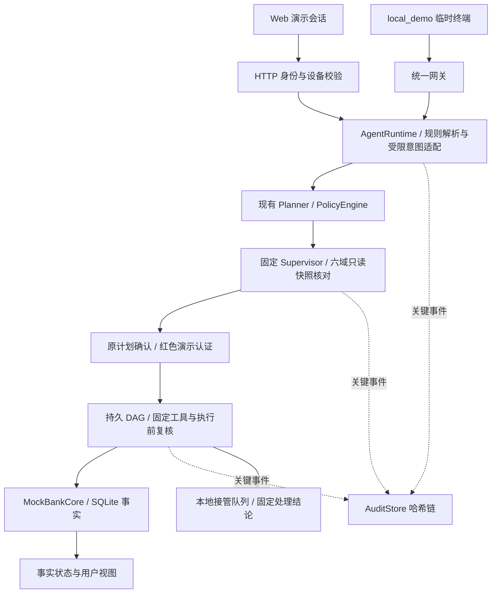

# 澜银行 AI 智能体架构与技术方案

## 1. 产品定位

澜银行 AI 智能体是“银行能力的自然语言操作层”，不是一个只会回答问题的客服机器人。其目标是让用户在一个会话中完成查询、分析、计划创建与业务执行，同时让每个金融动作都具备：

- **可理解**：把自然语言转成结构化意图与业务要素。
- **可解释**：执行前展示任务计划、风险等级、目标对象、金额、工具步骤。
- **可控**：模型不直接拥有资金权限，最终由服务端策略引擎决定是否允许工具调用。
- **可追溯**：每次计划、确认、认证、工具调用、结果和异常都带 `trace_id` 并写入审计。
- **可恢复**：支持暂停、取消、声明式补偿、熔断和人工接管登记；副作用不自动重试。

## 2. 分层架构

### 2.1 当前演示实现（T15，2026-10-22）

以下是已实现主链，不把未来生产系统画成已接入：



图示为职责关系，不表示绿色查询也等待用户确认：绿色按策略自动执行，黄色等待原计划确认，红色还需演示认证及再次确认。Supervisor 的计划核对目前限原转账模板；其他域按已授权来源产生分析，不是任意业务的自由规划。local_demo 使用独立临时数据，不与 Web 共享日常库。沙箱是独立 T07 演示，未接聊天代码生成，不在银行容器挂 Docker socket。依据：`app/banking_agent.py:2794/3023/3140/3431/3526/3671`、`app/supervisor.py:62/196/233`、`app/local_channel.py`。

### 2.2 生产目标分层（未全量实现）

以下为目标分层示意；真实核心、mTLS、生产身份与客服系统属于替换点，不代表已接入。D6 当前实现及边界见第 7 节；T06–T12 增量现状见第 8 节，目标示意不能当作功能全部完成的证据。

```text
┌────────────────────────────────────────────────────────────────┐
│ 渠道层                                                        │
│ Mobile App / Web / IM / Voice / Mini Program                  │
└───────────────────────────────┬────────────────────────────────┘
                                │ HTTPS / WebSocket
┌───────────────────────────────▼────────────────────────────────┐
│ Agent Gateway                                                  │
│ Session · Auth Context · Rate Limit · Idempotency              │
└──────────────┬────────────────┬─────────────────┬──────────────┘
               │                │                 │
       ┌───────▼──────┐ ┌───────▼────────┐ ┌─────▼───────────┐
       │ Guardrails   │ │ Agent Runtime  │ │ Audit / SIEM     │
       │ injection    │ │ parse-plan-run │ │ append-only log  │
       │ PII / policy │ │ pause / resume │ │ alert / replay   │
       └───────┬──────┘ └───────┬────────┘ └──────────────────┘
               │                │
       ┌───────▼────────────────▼──────────┐
       │ Policy & Consent Service           │
       │ RBAC/ABAC · risk · limits · MFA    │
       └──────────────┬────────────────────┘
                      │ typed tool calls
       ┌──────────────▼────────────────────┐
       │ Tool / Banking Capability Gateway  │
       │ balance · transfer · card · bill  │
       │ investment · subscription          │
       └──────────────┬────────────────────┘
                      │ mTLS / signed request
       ┌──────────────▼────────────────────┐
       │ Core Banking / CRM / Risk / OTP    │
       └───────────────────────────────────┘
```

## 3. Agent 生命周期

### 3.1 输入规范化

- 统一中文数字、金额、币种、日期与手机号表达。
- 以下多模态项为设计目标：当前已有可选 ASR 草稿入口，依赖显式同意和外部配置，离线默认关闭；未找到保留 audio_hash 的实现证据。
- OCR/截图提取与原图隔离存储仍为目标，未找到当前主链实现证据。
- 对输入做 Prompt 注入、敏感信息和越权意图检测。

### 3.2 意图与实体

下面是设计协议示意，不是当前接口所有字段都已实现的承诺；实际可选模型协议是 `app/llm_adapter.py` 的 SYSTEM_PROMPT 与受限实体校验，规则解析入口为 `IntentParser`。未找到 confidence/source_spans 全链留存实现证据。

```json
{
  "intent": "transfer",
  "entities": {
    "beneficiary_ref": "妈妈",
    "amount_cents": 20000,
    "note": "午餐"
  },
  "confidence": 0.98,
  "missing_fields": [],
  "source_spans": [{"field": "amount", "text": "200 元"}]
}
```

重要约束：模型输出不能直接触发转账；必须经过 Schema 校验、收款人解析、账户归属校验、额度核算和策略判定。

### 3.3 任务规划 DAG

复杂请求不是一个大 Prompt，而是一组可观测节点：

```text
转账
  ├─ A 解析金额与收款人
  ├─ B 收款人解析 ─┐
  ├─ C 余额与额度校验 ├─ D 展示摘要并请求确认
  ├─ E 强验证（红色） ┘
  └─ F 创建转账 → G 读取最终状态 → H 审计归档
```

上图为业务步骤示意；当前执行图由计划转换为有依赖边的链式 DAG，生日图使用 `action / delay / human_gate` 通用节点（单线程、不并行）。

节点状态：`pending → ready → running → succeeded | failed`，另有 `pending/ready → skipped`、`succeeded → compensated`。
任务状态：`running ⇄ paused`、`running → waiting_human → running | handoff`、`running → failed | completed`、`running/paused → compensating → cancelled`。非法转移抛 `ValueError`；建图拓扑排序拒绝环。
每个节点使用 `idem:{dag_id}:{node_id}`；补偿使用其 `:compensate` 派生键。幂等用于去重，不授权自动重试。

### 3.4 执行与结果

Agent 只可调用注册工具。下面是工具契约设计目标，不表示当前每个字段均由通用 JSON Schema 服务实现；实际参数和授权重校验见 `app/banking_agent.py:3671` 及相应工具适配器。设计要求声明：

- 输入 JSON Schema
- 所需权限
- 风险等级上限
- 是否有副作用
- 幂等键规则
- 超时与重试策略
- 可返回的结果字段

回复以工具事实为准：转账必须有已核实的最终成功状态和交易标识才可宣称转账完成；查询按对应工具事实展示，不要求凭空生成交易流水。PROCESSING/UNKNOWN 不宣称成功，失败或异常显示对应失败/待核实状态，不能由语言模型补写结果。依据：`app/transaction_views.py`、`tests/test_core_transaction_state.py:101`。

## 4. 核心模块

### 4.1 运行时

`app/banking_agent.py` 中 `AgentRuntime` 负责：

1. 接收消息并生成 `trace_id`。
2. 调用 `InjectionGuard`。
3. 用 `Planner` 创建计划。
4. 由 `PolicyEngine` 计算风险级别。
5. 绿色计划直接执行；黄色计划等待明确确认；红色计划等待强认证和明确确认。
6. 每个工具调用前后写审计。
7. 失败计数达到阈值后触发 `CircuitBreaker`。

### 4.2 策略模型

| 级别 | 规则 | 示例 |
|---|---|---|
| 绿色 | 策略明确允许自动执行的查询 | 余额、流水、账单、理财收益；不含订阅查询 |
| 黄色 | 明确用户确认 | 日累计不超过 1000 元的转账、订阅查询、取消订阅 |
| 红色 | 高金额、身份或资产变更 | 日累计超过 1000 元转账、挂失解挂、密码修改、理财申购赎回 |

实际生产规则还应叠加用户画像、设备风险、收款人历史、地理位置、行为基线、黑名单与监管规则。

原文权限表将订阅查询列为黄色，不能凭“只读”降级。当前分组来源为 `config/policy.json:9/16/22` 与 PolicyEngine；红色仅有演示 OTP，真实 MFA 属于生产替换点。规则不来自 Prompt。

### 4.3 渠道与会话

以下为生产渠道目标。当前仅 Web 和 local_demo，以及需显式配置的外部 ASR 草稿入口；未接 App 深链、真实 IM、推送、生物识别或真人后台。已实现本地接管队列见 T09，不等于下面所有后台目标已交付。

- App：优先使用，支持深链、推送、设备绑定与生物识别。
- IM：只开放查询、通知和进入 App 的确认链接；高风险操作不能在非受控 IM 内完成。
- 语音：支持免手操作查询，资金动作必须转视觉确认页或二次认证。
- 后台：支持客服/运营人工接管，接管后模型停止副作用工具调用。

## 5. 数据与隐私

以下列表为生产设计目标，不是现有脱敏能力或供应商合约已验收。当前离线模式不调用外部模型；可选 LLM 仅发送用户文本、不附账户查询结果，但不能声称用户原文外发前已有完整 PII 脱敏。语音显式启用后会向外部 ASR 发送经同意的音频，仅适用虚构演示；真实客户文本/音频不得直接沿用该演示配置。依据：`app/llm_adapter.py:1/112`、`app/speech_adapter.py:17/29`、`app/banking_agent.py` 的 `_transcribe_voice`。审计脱敏函数与完整隐私合规审查不是一回事。

- 账号、手机号、身份证、卡号在模型上下文前完成最小化与掩码。
- 模型只看到任务所需字段，不发送全量交易流水。
- 生产环境采用客户授权范围内的短期 token，禁止把长期密钥放入 Prompt。
- 审计日志记录必要决策证据，敏感字段做字段级加密或 tokenization。
- 模型供应商采用零留存、区域隔离、可审计的企业协议；不允许将客户数据用于外部训练。

## 6. 非功能指标

下表是设计目标/建议，不是已经测得的 P95、成功率、审计完整率或生产服务承诺；未找到对应完整压测和生产验收报告。

| 指标 | Demo 目标 | 生产建议 |
|---|---:|---:|
| 查询首屏反馈 | < 1 秒 | P95 < 1.5 秒 |
| 计划生成 | < 2 秒 | P95 < 3 秒 |
| 工具成功率 | > 99%（Mock） | > 99.9% |
| 重复转账 | 0 | 以幂等键与核心账务为最终约束 |
| 审计完整率 | 100% | 100%，不可篡改存储 |
| 高风险误放行 | 0 | 0，宁可降级人工 |

## 7. D6 通用任务 DAG：当前已实现边界

### 7.1 调度与业务校验

- `app/task_dag.py`：`DagNode`、`TaskDag`、`DagExecutor`、`TaskDagStore`；不依赖银行运行时，不授予权限。
- `AgentRuntime.execute()` 将计划交给 DAG，节点仍经 `_execute_steps()` / `_execute_step()` 进入既有工具白名单、PolicyEngine、余额/额度/身份重校验。金额保持整数分；模型不能指定跳过确认或认证。
- 转账节点必须查询核心最终状态；`processing` 只提示“银行还在确认这笔交易，请不要重复操作”。人工批准不能把结果不明的银行操作改成成功。
- 失败 fail-fast，跳过后续节点，并对已成功且声明 compensation 的节点按逆拓扑序补偿。失败分支在任务仍为 running 时补偿后记 failed，避免引入未批准的 `failed → compensating` 转移；显式取消才使用 compensating → cancelled。
- 暂停是节点边界的协作式暂停，不能中断已被银行受理的调用。无补偿声明的已完成转账/礼品订单不会被自动冲正或退款；补偿失败/结果不明只保留证据等待人工核实，不自动重试。

### 7.2 持久化、恢复与生日迁移

`task_dags(dag_id, trace_id, actor_id, status, state_json, created_at, updated_at)` 保存完整图；每次状态转移同步提交快照和现有 AuditStore 哈希链事件，提交失败停止执行。

C8 恢复入口加载 running/paused/waiting_human 等非终态图：

1. 已成功节点不再次调用工具；暂停图不自动推进。
2. running 的转账通过核心幂等键/流水查询恢复，不重新发起转账；未知结果停在人工核实边界。
3. 普通计划中断后的剩余动作须生成新确认卡片，强认证过期则重新认证；不得跳过确认节点。
4. 生日联动为“锁预算 A → delay-B → 鲜花 B”和“锁预算 A → delay-C → 蛋糕 C”两条依赖链（单线程调度；保留旧版按日期分别到期语义）；提前确认的到期节点可由本地调度器执行。`core_workflow_effects` 为 Mock 锁定/订单/补偿持久化证据，重启只从证据恢复投影，不再次下单。
5. `migrate_linkage_to_dag()` 幂等读取旧 `linkage_tasks` 生成等价图；启用时收养为 DAG 执行权，旧表保留、不再双写。旧数据无设备字段，迁移仅支持现有演示身份，绑定 demo-device；生产迁移须重新验证身份和授权。

`config/features.json` 的 `dag.enabled=true` 是默认主路径。关闭后新普通计划走旧执行器，仅未收养的旧生日任务允许旧调度器接手；**已被 DAG 收养的任务绝不回交旧调度器**，须重新启用 DAG 后处理。此开关不是对存量 DAG 的无损降级承诺。关闭所需旧路径保留，其余启用状态下不再调度/双写旧任务。

### 7.3 会话鉴权 API

本节 DAG 接口复用 D1 会话校验；actor/device 从会话取得，必须匹配任务，不能信任请求体中的身份。无会话或跨用户/设备操作拒绝并审计。生产需替换静态演示会话；这不表示健康/能力/旧通知等所有 HTTP 端点均需要认证，详见 API 说明。

| 接口 | 输入 | 行为 |
|---|---|---|
| `GET /api/dag/state?dag_id=...` | dag_id | 仅返回节点依赖、类型与状态，不暴露凭证/原始结果 |
| `POST /api/dag/pause` | dag_id | 在安全节点边界暂停 |
| `POST /api/dag/resume` | dag_id | 生日按原授权恢复；普通计划返回新的确认要求 |
| `POST /api/dag/cancel` | dag_id | 停止剩余步骤并执行已声明补偿；未知银行结果拒绝取消 |
| `POST /api/dag/approve` | dag_id、decision | approve/reject/handoff；approve 必须携带原确认 action_token，强认证还须有效 credential_id |

`approve` 复用既有 `confirm()`，不是绕过认证的快捷入口。handoff 仅持久化人工接管请求并停止模型执行，**未接通真人客服**。原 `/api/cancel` 同步关闭确认计划及对应 DAG。当前 DAG 专用控制通过 API 演示，未新增前端专用控制面板。

### 7.4 验证证据与生产替换点

- `tests/test_task_dag.py`：非法转移、环、拓扑序、逆序补偿、幂等、未知结果与持久化失败停止。
- `tests/test_dag_migration.py`：旧数据等价迁移、重复迁移、flag 回退、收养后不回交旧调度器。
- `tests/test_dag_integration.py`：Agent 生日主链、确认门、暂停重启、新确认、取消补偿、人工拒绝/接管、会话隔离、认证过期、扣款后 checkpoint 失败恢复、真实 HTTP 路由。
- 真实核心/商户替换必须提供持久化幂等指令和只读状态查询；不能以本地 SQLite 证据代替银行最终账务。
- SQLite + 单进程调度器不是分布式工作流；生产需事务存储/CAS、任务归属锁、受监督调度与授权重验证。哈希链需接真实 WORM/SIEM，人工请求需接工单与人员身份系统。
- C8 的 RPO“已确认落盘任务状态零丢失”、RTO“演示脚本在限定等待窗口内恢复可查询”仅为**单机演示级目标**；不含磁盘损坏、异地切换或银行生产灾备验收，不宣称完成监管审批。

## 8. T06–T12 当前增量能力（2026-10-22）

- T06：`conversation_context.py` 提供同身份/设备/渠道/会话的有限转账补齐；不是任意长对话记忆。
- T07：`sandbox_execution.py` 提供独立 Docker 受限整数计算/隔离探针，不向聊天开放任意代码执行，也未接入真实模型自动生成代码。
- T08：Web 外增加明确标注的 local_demo 终端适配器；没有真实 IM 接入。
- T09：`handoff_queue.py` 提供本地排队、坐席领取、固定结论与本人查询；结单不代表银行交易完成或真人已接通。
- T10/T11：契约、来源绑定、六域只读注册与适配器已实现，领域建议没有直接执行权限。
- T12：`supervisor.py` 固定路由、来源比对、冲突保留与原转账模板核对；不替代 Planner/PolicyEngine，不支持任意 Agent DAG 自由执行。

源码完整验收与限制见《需求追踪矩阵》；最新源码通过不能证明旧 Docker 镜像或完整离线包已更新。

## 9. 核心算法与验证对应（T15）

| 算法/机制 | 处理规则与异常边界 | 实现 / 验证 |
|---|---|---|
| 意图与要素解析 | 默认规则；可选模型仅返回受限 JSON，非法/超时不赋予执行权限；缺金额/目标先澄清 | `app/banking_agent.py:1825/2089`、`app/llm_adapter.py:112`；`tests/test_d5_llm_chain.py`、`tests/test_conversation_context.py` |
| 权限与执行前复核 | 整数分计算日累计，按既有策略分色；确认 token、身份/设备、认证和资金约束在平台复核，副作用不自动重试 | `config/policy.json`、`app/banking_agent.py:2014/3023/3140/3671`；`tests/test_daily_transfer_policy.py`、`tests/test_auth_credentials.py` |
| 多域协调 | 固定路由按需分发平台快照；精确比对来源/身份，冲突保留并阻断不确定计划，不投票生成授权 | `app/supervisor.py:62/196/233`；`tests/test_supervisor.py`、`tests/test_supervisor_integration.py` |
| DAG 与恢复 | 拓扑拒环、节点状态转移、持久 checkpoint；成功节点不重做，未知交易只读核查，暂停在节点边界，回退只执行已声明补偿 | `app/task_dag.py:128/199/551`；`tests/test_task_dag.py`、`tests/test_dag_migration.py`、`tests/test_dag_integration.py` |
| 事实与审计 | PROCESSING/UNKNOWN 不伪报成功；关键事件写 SQLite 哈希链，校验篡改并冻结；不是生产 WORM | `app/transaction_views.py`、`app/banking_agent.py:714/909/3526`；`tests/test_core_transaction_state.py`、`tests/test_c5_audit_chain.py` |

当前记录 `data/verification/t03-20261022-150008-756330/report.json` 为 543 项完整源码回归通过、0 跳过、0 ResourceWarning。没有完整生产压测、真实银行或最新离线发行包验收结论。T14 因 Docker 引擎不可用保留未验收；RAG/微调不纳入本阶段。提交源文件及缺件见 `submission/交付说明.md`。

## 10. T18功能现状与T19技术报告（2026-10-22）

T18在原链增量补齐生日独立提前天数（默认花前2天、蛋糕前1天，分别支持0至365整数天）、单账户资产来源范围、新一轮本地求助和本页卡片列表隐藏/恢复。隐藏偏好不改变核心状态、业务核验或审计；未知客服结果复用请求标识重试，只有查询确认旧工单结单后才可主动新建。实现依据为 `IntentParser._birthday_entities`、`MockBankCore.balance`、`AgentRuntime.create_birthday_linkage` 和 `app/static/app.js` renderCardDisplay / showLocalHandoffStatus；测试见 test_birthday_linkage、test_agent、test_banking_flow_ux、test_handoff_queue。

T19依据现有专业文档汇编 `docs/技术文档.md`，生成 `submission/澜银行AI智能体_技术文档.pdf`，采用参考技术文档的A4封面、分级目录、章标题和页码形式。PDF包含可见架构/生日DAG图、算法、安全、测试与部署，30条证据按实际源码定位生成；构建工具 `scripts/build_technical_document.py` 使用开发侧PDF库，不加入应用运行依赖。旧设计段落仍为历史/生产目标，不能直接当当前功能声明。

本批实际完整回归 `data/verification/t03-20261022-191929-286874/report.json`：563项通过、0跳过、0 ResourceWarning、日常数据库指纹不变。PDF分页、字体、目录和逐页渲染的验收见 `data/verification/t19-20261022/`。不修改业务代码、不重建镜像；平台格式/上传、真实读屏和播放、PPT参考改版及T14仍待后续处理。
