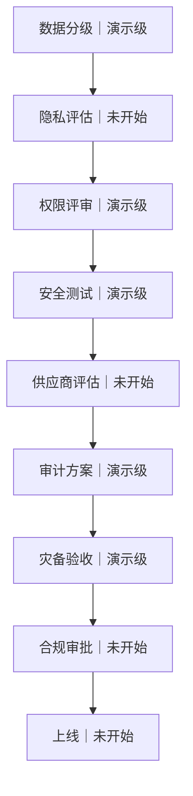

# 生产上线门禁与数据分类

> C9 · 2026-09-21 · 范围：截至 C4 提交 `0361908` 的离线演示主链路。本文只记录数据使用边界、工程现状和拟议上线流程，不构成法律意见、监管结论或生产上线许可。

## 一、边界声明

**本作品为竞赛演示与工程验证平台，未完成银行生产级灾备验收与监管审批，不宣称符合银行监管要求，展示的是合规实施路径。**

本文的“演示级”仅表示有局部实现、方案或离线验证记录，不表示相应生产门禁已通过；“未开始”表示本项目未提供该生产评审或审批的启动及签署证据。测试通过、接口可运行、健康检查通过，都不能替代银行的组织评审、独立验收和审批。

以下数据分类按来源、用途及环境划分，是本项目的三类管理口径，**不是对银行或监管数据分级标准的替代**。未来生产接入须重新确定适用要求，完成正式分类和审批。

## 二、数据三级分类

| 类别 | 定义及允许用途 | 管理边界 | 本项目现状 |
| --- | --- | --- | --- |
| 演示数据 | **虚构、脱敏**，用于离线讲解、竞赛界面和演示报告；不得使用真实客户或真实账户资料 | 使用虚构身份、余额及交易；展示和导出按字段脱敏；确认凭据、认证状态等不得当作公开演示素材 | 有虚构账户、收款人、账务和家庭关系夹具；已有部分审计/输出脱敏。**不宣称所有存储字段均已脱敏**，内部恢复状态等仍是受限存储，见逐表盘点 |
| 测试数据 | 模拟生产字段结构、故障和攻击输入，用于隔离测试，**不进入生产** | 不从生产库直接拷贝；测试账号、固定验证码、攻击语料、临时数据库与生产隔离；测试后按场景清理，留存报告须检查敏感内容 | 有临时 SQLite 测试库、注入/攻击矩阵及重启演练。部分用例故意包含敏感格式字符串以验证脱敏，不能把原始测试夹具当公开导出物；尚无统一生产发布隔离验收 |
| 生产数据 | 真实客户、账户、交易、关系、身份凭证及由其派生的风险、审计和通知数据 | 必须具备**授权、访问控制、审计、加密、保留与删除策略**；覆盖采集、使用、传输、存储、共享、备份和销毁 | 离线主链路未接入真实银行核心；未完成生产数据授权和治理验收。本文不批准采集或导入生产数据 |

说明：

- 字段使用虚构姓名、随机 ID 或掩码，不自动等于不可识别；存在关联能力时仍须评估用途和访问范围。
- 本盘点依据代码结构与默认夹具，**未检查运行中数据库的实际记录**，不保证使用者从未输入真实信息。若误入真实资料，应停止展示和传播，限制访问并由责任人员处理，不得继续按“演示数据”解释。
- 本文约束后续实施，不代表已新增全库加密、统一 DLP、生命周期自动清理或生产发布拦截功能；本任务不修改代码。

## 三、逐表标注现状

以下列出离线主链路定义的 **10 张业务/运行表**。默认演示运行产生演示数据，隔离单测和演练产生测试数据；**相同表结构不构成将测试库迁入生产的依据**。SQLite 内部维护表不属于业务表。可选后端契约、工作区中的配置草稿或未验收连接能力，不作为已投产证据；切换存储后必须重新盘点实际表、队列和备份。

| 表名 | 主要数据 | 当前类别与实际保护边界 | 生产接入前待补控制 |
| --- | --- | --- | --- |
| `core_transactions` | 交易号、幂等键、账户主体、金额、收款人、备注、状态及迁移历史 | 演示/测试；MockBankCore 的模拟账务，金额为整数分。收款人、备注等业务字段不是统一脱敏存储，未证明数据库加密 | 核心账户访问控制、真实交易授权、敏感字段保护、对账审计、账务保留和删除/归档审批 |
| `audit_events` | 用户/设备/任务标识、操作、风险、决策原因、工具结果及哈希链 | 演示/测试；`AuditStore.write` 写入前脱敏，支持链校验；SQLite 哈希链**不是 WORM，也不是加密** | 独立审计权限、可信签名/密钥托管、WORM/SIEM、访问审计、保留期限及受控销毁；不能随普通测试数据清理 |
| `linkage_tasks` | 生日联动任务、主体、节点、日期、执行状态及结果 | 演示/测试；JSON 状态持久化，不把业务状态视为已脱敏日志；不宣称联动流程获得银行级灾备保证 | 任务最小字段、本人授权、节点访问控制、加密、留存及跨系统对账/恢复验收 |
| `task_checkpoints` | 计划、实体、确认 token、认证凭证及任务恢复状态 | 演示/测试；含恢复必需的原始状态，**不是公开日志或可直接分享的报告**；不宣称抗离线篡改或已做字段加密 | 凭据最小化/摘要化、密钥托管与字段加密、服务账号隔离、最短必要留存、失效与删除机制、备份同级保护 |
| `readiness_probe` | 数据库可写性探测值 | 演示/测试运行数据；探测写入后回滚，不承载客户业务信息；就绪不等于合规可上线 | 最小探针权限、避免写入业务字段、探测告警与运维访问控制 |
| `notification_subscriptions` | 主体、通知通道、目标及订阅事件类型 | 演示/测试；App/SMS 使用模拟目标，守护通道校验有效关系；不代表真实通知同意或供应商签约 | 可核验订阅授权、撤销机制、接收方最小披露、联系方式加密和保留删除策略 |
| `notification_events` | 风险/客服事件、trace、事件键、消息载荷与派发状态 | 演示/测试；载荷经现有脱敏函数处理后持久化；不是通用 DLP | 事件分级、字段最小化、发布/消费权限、消息加密、审计与过期清理 |
| `notifications` | 事件与订阅关联、目标、通道、载荷及本地回执 | 演示/测试；`LOCAL_QUEUED` 仅代表本地模拟入队，**不表示真实送达**；失效守护关系可抑制通知 | 供应商及分包方评估、真实送达回执、接收方授权、加密、保留期限及删除证明 |
| `guardianships` | 守护人/被守护人、授权类型、每日额度、生效/到期时间与撤销状态 | 演示/测试；默认关系来自配置夹具，持久化撤销和有效期；**不是已取得的真实本人授权书** | 实名关系核验、本人同意、审批版本、变更审计、关系信息访问控制与加密、授权材料保留策略 |
| `guardianship_usage` | 授权关系、任务、业务日、金额及额度预占/消费/释放状态 | 演示/测试；独立持久化额度记录，处理不明状态时保守保留；不声明分布式一致性或生产账本能力 | 与核心对账、条件扣额度/版本控制、授权变更审计、加密及与账务一致的归档/删除策略 |

代码依据：

- `app/banking_agent.py`：`MockBankCore`、`AuditStore`，定义核心账务、审计及联动任务表。
- `app/recovery.py`：`RecoveryStore`，定义任务检查点和就绪探测表。
- `app/notification_bus.py`：`NotificationBus`，定义三张事件/通知表。
- `app/guardianship.py`：`GuardianshipStore`，定义家庭关系和额度使用表。

### 表外数据同样纳入治理

| 数据载体 | 当前情况 | 边界 |
| --- | --- | --- |
| 内存账户、卡片、流水、设备画像；`config/guardianship.json` | 演示夹具包含虚构账户、初始余额及公开固定会话；部分业务状态在内存中 | 固定会话和验证码只是身份替身，不得携带到生产；未隔离的业务不能借用演示权限接入真实账户 |
| `eval/`、`tests/`、故障演练临时文件与报告 | 模拟攻击、故障及结构化测试输入，可含敏感格式测试值 | 测试库与原始夹具不进生产；分享报告前复核；临时清理机制不等于统一企业数据保留策略 |
| 用户输入、模型请求、工具响应、HTTP/应用日志及前端导出 | 离线模式不依赖外部模型；已有局部输入阻断、脱敏和最小披露规则 | 不保证对任意输入、异常日志及外部模型配置全链路防泄露；启用外部服务前须先评估数据流、接收方和留存用途 |
| 数据库副本、备份、日志副本及密钥/配置 | 有本地演示存储及适配契约，无生产加密/密钥治理验收 | 备份不得降低数据级别；秘密不得进入日志、仓库或公开报告；需单独约定备份失效、删除验证和例外保留流程 |

保留与删除期限不在本文虚构具体年限。未来由银行数据、业务、安全和合规责任方确定每类数据的用途、保留起点、期限、访问范围、删除/匿名化方式及适用的暂停删除情形；同步覆盖缓存、队列、导出和备份，并保留执行证据。

## 四、生产上线门禁流程图

纯文本顺序：**数据分级 → 隐私评估 → 权限评审 → 安全测试 → 供应商评估 → 审计方案 → 灾备验收 → 合规审批 → 上线**。

箭头表示拟议的审查依赖关系，**不表示当前已获准推进**。任一关卡缺少批准证据或存在未解决问题，应停止上线并退回整改；整改后重新评审。数据来源、模型/供应商、授权范围或存储架构变化时，应重新评估受影响关卡。具体审批组织与签署权限由接入银行确定。

### 各关卡当前状态与待取得证据

| 关卡 | 当前状态 | 现有依据及边界 | 生产放行前待取得证据 / 建议责任方 |
| --- | --- | --- | --- |
| 数据分级 | **演示级** | 本文覆盖默认数据来源和表结构；未形成银行正式数据资产目录或现场数据核验 | 经确认的数据清单、字段/数据流图、责任人、分类结果与环境隔离方案；数据治理/业务 |
| 隐私评估 | **未开始** | 未提供真实数据处理的必要性、授权或隐私影响评估签署材料；脱敏函数不等于隐私评估 | 处理目的、必要性、最小化、适用授权、对外提供/委托处理、留存删除及主体请求处理方案；隐私/合规/业务 |
| 权限评审 | **演示级** | C3 凭证绑定、C4 家庭矩阵与本人认证可离线验证；仍有固定身份夹具和演示接口 | 实名 IAM、角色/账户/设备/工具权限矩阵、职责分离、授权撤销、运维特权及接口访问评审；身份/安全/业务 |
| 安全测试 | **演示级** | T6/C6 固定攻击矩阵及专项回归可跑；不覆盖真实银行环境或全部语义攻击 | 明确范围的代码审查、依赖/配置检查、独立渗透与业务逻辑测试、问题闭环及复测报告；安全/测试 |
| 供应商评估 | **未开始** | 存在接口契约及模拟器，不代表外部模型、核心、短信、云或密钥供应商已获准接入 | 供应商清单、数据使用/留存边界、服务能力、分包及退出安排、合同与安全评估记录；采购/安全/合规 |
| 审计方案 | **演示级** | C5 SQLite 脱敏哈希链、校验与冻结演示；非 WORM、非独立密钥签名或真实 SIEM 联调 | 事件目录、独立写入/查询权限、可信完整性证明、WORM/SIEM、密钥生命周期、保留销毁和告警处置验收；审计/安全运营 |
| 灾备验收 | **演示级** | C8 本机进程 kill/重启可验证有限场景的任务恢复及防重放；**未完成银行生产级灾备验收** | 银行确认的 RPO/RTO、备份恢复、存储/主机/跨站故障、切换回切、对账、负载与演练签署材料；运维/业务连续性/核心系统 |
| 合规审批 | **未开始** | 未取得银行合规审批或监管审批；本文不判断具体场景应履行哪些法定程序 | 由银行确认适用要求及审批/报备路径，补齐相关审查意见和所需批准材料；银行合规/法务及有权机构 |
| 上线 | **未开始** | 离线演示服务可启动，不是生产发布许可 | 前序关卡批准证据、变更审批、关闭演示入口/身份、发布与回退方案、值守及监测验收；变更管理/运维/业务 |

**当前结论：不能依据本项目的演示结果放行生产上线。** 即使某项演示测试通过，其门禁状态仍为“演示级”，直到获得对应生产环境的正式证据及有权人员批准。

## 五、证据引用与使用限制

以下材料说明“如何验证演示控制”，不是生产合规证明：

- C1 核心交易状态、幂等及最终状态查询：`docs/C1核心账务一致性与Adapter接口.md`。
- C2 事件与通知、C3 认证、C4 家庭授权：对应 C 系列文档，以及 `tests/test_c2_risk_notifications.py`、`tests/test_auth_credentials.py`、`tests/test_c4_guardianship.py`。
- C5 审计与脱敏：`docs/C5审计哈希链与篡改检测.md`、`tests/test_c5_audit_chain.py`。
- C6 攻击矩阵：`docs/C6-红队攻击矩阵.md`、`eval/attack_matrix.json`、`tests/test_c6_attack_matrix.py`。
- C8 恢复边界：`docs/C8-故障恢复演练.md`、`scripts/drill_recovery.py`、`tests/test_c8_recovery.py`。其中“任务状态零丢失”为有限条件下的演示级验证，不代表生产 RPO 承诺或银行灾备验收。

对外介绍、申报、演示页面和后续交付均应沿用本文边界，不使用“已符合银行监管要求”“已获银行生产认证”“已通过生产灾备验收”等表述。新增适配器、测试数量增加或单次演练成功，均不能自行改变上述门禁状态。
